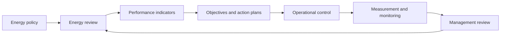

# Defining and Describing Energy Management

- _Energy management turns energy from an overhead into a continuously measurable and improvable business process._
- Energy management is the coordinated practice of establishing balances in energy sourcing and use, then continually improving energy performance. [^mde24y] In organizational settings, it commonly operates through an Energy Management System (EnMS): interconnected policies, objectives, processes, and procedures designed to improve energy efficiency and performance. [^bsgb3p]
- The concept applies to factories, commercial buildings, campuses, transport systems, utilities, and households. It combines energy review, measurement, operational control, procurement, technology selection, and management accountability rather than treating efficiency as a one-time technical project. [^bsgb3p] [^buspw5]
- ISO 50001 formalizes this approach by requiring organizations to establish, maintain, and improve an EnMS; its current core edition was published in 2018, with a climate-related amendment issued in 2024. [^a2g1f1] [^uro4yk]

# Uses in Context

- In **business operations**, “energy management” describes the integration of energy data, accountability, and improvement actions into daily processes and long-term planning. [^qn20s6]
- In **standards and compliance**, it refers to implementing an EnMS that meets ISO 50001 requirements for policy, objectives, measurement, auditing, and continual improvement. [^bsgb3p] [^a2g1f1]
- In **facilities management**, the term covers identifying major energy uses, establishing baselines, monitoring performance, and improving equipment or operating practices. [^4p7fyz] [^uqqb39]
- In **industrial engineering**, it describes systematic control of energy-intensive processes and equipment, especially where energy performance can be linked to operating conditions. [^4p7fyz] [^buspw5]
- In **climate strategy**, energy management connects efficiency and consumption reductions with emissions objectives and organizational responses to climate-related issues. [^uro4yk] [^sz61dg]

# History of Use

## Origins

- The modern organizational meaning of energy management developed through management-system thinking rather than from a single software product or technology. ISO 50001 was first published in 2011 to help organizations in all sectors use energy more efficiently through an EnMS. [^bsgb3p] [^buspw5]
- The foundational shift was conceptual: energy management became a repeatable management system—not merely a technical energy-saving program—with requirements covering energy review, measurement, reporting, procurement, design, and documentation. [^buspw5]
- The framework does not impose one universal consumption limit; instead, it requires each organization to build an approach suited to its facilities, processes, equipment, operating conditions, and significant energy uses. [^buspw5]

## Evolution

- **2011 — Formal management-system standardization:** The first edition of ISO 50001 established a structured, organization-wide system for improving energy performance. [^bsgb3p] [^buspw5]
- **2018 — Integration and stronger performance logic:** ISO 50001:2018 aligned more closely with other ISO management standards and strengthened attention to leadership, Energy Performance Indicators, energy baselines, and demonstrable improvement. [^mde24y] [^buspw5]
- **2024 — Climate-context expansion:** Amendment 1:2024 added climate-change considerations to the context of the organization and interested-party requirements for certified management systems. [^uro4yk] [^sz61dg]

# Best Real-World Examples

- [ISO 50001 Energy Management System](https://www.iso.org/standard/69426.html) — a globally recognized framework for continual improvement in energy performance. [^mde24y] [^bsgb3p]
- [Energy Performance Indicators](https://www.enel.it/en-us/blog/guide/certificazione-iso-50001) — metrics used to track energy performance against a baseline over time. [^a2g1f1]
- [Energy review and significant energy uses](https://greencalculus.com/standards/iso-50001-energy-management/) — an analytical process for identifying major consumption and high-potential improvement areas. [^4p7fyz]
- [Building energy monitoring](https://www.dreso.com/de/en/dreso-blog/article/iso-50001-energy-management) — data-driven monitoring that connects consumption, influencing factors, operational control, and accountability. [^qn20s6]
- [ISO 50001 certification audits](https://www.tuv-nord.com/us/en/services/energy/iso-50001-energy-management/) — independent assessment of whether an organization’s EnMS supports continual improvement in energy efficiency, use, and consumption. [^sz61dg]
- [Energy management action plans](https://www.kiwa.com/nl/en-nl/about-kiwa/news/iso-50001-as-a-foundation-for-future-proof-energy-management/) — practical programs moving from energy scans to objectives, actions, monitoring, audits, and management review. [^uqqb39]

# Case Studies

**ISO 50001 as an organizational operating model.** Organizations implementing ISO 50001 begin by defining the EnMS scope, conducting an energy review, identifying significant energy uses, setting performance indicators and baselines, and establishing objectives and action plans. [^4p7fyz] [^uqqb39] The approach changes energy efficiency from an isolated retrofit exercise into a recurring cycle involving operations, procurement, design, measurement, internal audit, and leadership review. [^bsgb3p] [^buspw5] This illustrates the central idea of energy management: durable gains depend on institutional processes as much as on efficient equipment.

**From annual reporting to daily operational control.** Recent interpretations of ISO 50001 emphasize that organizations should not merely maintain a formal system or report a few annual indicators; they should understand energy use, influencing factors, and performance in everyday operations. [^qn20s6] Monitoring and accountability therefore become part of facility and process control, procurement decisions, and strategic planning. [^qn20s6] The case demonstrates how energy management has evolved from periodic conservation reporting toward continuous, data-informed operational improvement.

**Energy review as the decision engine.** The energy review functions as the technical foundation of the EnMS: it identifies where energy is consumed, which uses are significant, what factors influence consumption, and where improvement opportunities exist. [^4p7fyz] [^uqqb39] The resulting baselines and Energy Performance Indicators allow organizations to distinguish genuine performance changes from changes caused by weather, production, occupancy, or other operating conditions. [^a2g1f1] [^4p7fyz] This shows why measurement architecture is central to the concept: without a credible baseline and relevant indicators, claims of improvement are difficult to verify.

***

# Sources

[^mde24y]: 2026, Oct 06. [pecb.com](https://pecb.com/). [ISO 50001 Transition](https://pecb.com/en/whitepapers/iso-50001-transition). Updated: 2026, Nov 04. Generated: 2026, Nov 06. [Perplexity](https://www.perplexity.ai/) API response.
[^bsgb3p]: 2026, Oct 05. [pecb.com](https://pecb.com/). [ISO 50001 Energy Management System](https://pecb.com/en/whitepapers/iso-50001-energy-management-system). Updated: 2026, Nov 05. Generated: 2026, Nov 06. [Perplexity](https://www.perplexity.ai/) API response.
[^a2g1f1]: 2026, Aug 27. [enel.it](https://www.enel.it/). [ISO 50001 certification: what it is and benefits for companies](https://www.enel.it/en-us/blog/guide/certificazione-iso-50001). Updated: 2026, Nov 03. Generated: 2026, Nov 06. [Perplexity](https://www.perplexity.ai/) API response.
[^4p7fyz]: 2026, Oct 23. [greencalculus.com](https://greencalculus.com/). [ISO 50001: Energy Management System Standard](https://greencalculus.com/standards/iso-50001-energy-management/). Updated: 2026, Nov 07. Generated: 2026, Nov 06. [Perplexity](https://www.perplexity.ai/) API response.
[^qn20s6]: 2026, Aug 07. [dreso.com](https://www.dreso.com/). [ISO 50001 Energy Management](https://www.dreso.com/de/en/dreso-blog/article/iso-50001-energy-management). Updated: 2026, Oct 04. Generated: 2026, Nov 06. [Perplexity](https://www.perplexity.ai/) API response.
[^buspw5]: 2026, Mar 27. [audit-advisor.com](https://audit-advisor.com/). [The Evolution of ISO 50001: Key Editions and Major Changes](https://audit-advisor.com/en/iso-information-portal/s3hfkux471-the-evolution-of-iso-50001-key-editions). Updated: 2026, Sep 21. Generated: 2026, Nov 06. [Perplexity](https://www.perplexity.ai/) API response.
[7]: 2026, May 09. [itotconvergentie.nl](https://itotconvergentie.nl/). [ISO 50001: energy management explained | IT/OT Convergence](https://itotconvergentie.nl/en/iso-50001). Updated: 2026, Oct 22. Generated: 2026, Nov 06. [Perplexity](https://www.perplexity.ai/) API response.
[^uqqb39]: 2026, May 12. [kiwa.com](https://www.kiwa.com/). [ISO 50001 Energy Management EED EPBD IV Certification | Kiwa](https://www.kiwa.com/nl/en-nl/about-kiwa/news/iso-50001-as-a-foundation-for-future-proof-energy-management/). Updated: 2026, Nov 05. Generated: 2026, Nov 06. [Perplexity](https://www.perplexity.ai/) API response.
[^uro4yk]: 2026, May 25. [mdpi.com](https://www.mdpi.com/). [Baseline, Benefits, Barriers, and Beyond: A Review of ISO ...](https://www.mdpi.com/1996-1073/19/11/2550). Updated: 2026, Nov 04. Generated: 2026, Nov 06. [Perplexity](https://www.perplexity.ai/) API response.
[^sz61dg]: 2026, Mar 27. [tuv-nord.com](https://www.tuv-nord.com/). [50001 Certification | Energy Management Systems | TUV USA](https://www.tuv-nord.com/us/en/services/energy/iso-50001-energy-management/). Updated: 2026, Aug 22. Generated: 2026, Nov 06. [Perplexity](https://www.perplexity.ai/) API response.
