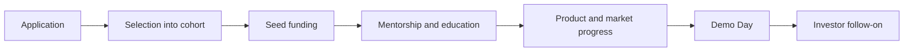

[[vertical-toolkits/Alternatives/Venture-Capital-Firms/Y Combinator|Y Combinator]]
[[vertical-toolkits/Alternatives/Venture-Capital-Firms/Antler|Antler]]
[[vertical-toolkits/Alternatives/Venture-Capital-Firms/Seedcamp|Seedcamp]]
[[vertical-toolkits/Alternatives/Venture-Capital-Firms/LAUNCH Accelerator|LAUNCH Accelerator]]
[[vertical-toolkits/Alternatives/Venture-Capital-Firms/TechStars|TechStars]]
[[vertical-toolkits/Alternatives/Venture-Capital-Firms/500 Global|500 Global]]

# Defining and Describing Startup Accelerators

- _A startup accelerator compresses years of early-company learning into a short, structured race toward product, traction, and investment._
- A startup accelerator—also called a seed accelerator—is a fixed-term, cohort-based program for early-stage companies that combines seed funding, mentorship, education, and investor access, usually ending in a public Demo Day. [^iuq120] [^u4zkm3] [^0m958d]
- Accelerators generally target startups that have progressed beyond the earliest idea stage and help them reach an investable milestone through programs lasting roughly one to twelve months. [^u4zkm3]
- The standard model commonly exchanges a small equity stake for capital and support; many programs run for about three months. [^iuq120] [^eyk2tu]
- The concept is distinct from a traditional incubator because the accelerator is time-bounded, cohort-based, and organized around rapid progress toward fundraising or market validation. [^u4zkm3] [^0m958d]

## Uses in Context

- **Fundraising:** “Accelerator” describes a program that supplies an early check and prepares founders for later venture investment. [^iuq120]
- **Founder development:** The term invokes structured mentorship, weekly sessions, peer learning, and guidance on product, growth, hiring, and fundraising. [^iuq120]
- **Market validation:** Programs use a concentrated cohort period to push teams toward evidence that customers want the product and that the company can grow. [^u4zkm3]
- **Investor access:** “Demo Day” commonly refers to the culminating event where participating startups pitch to investors. [^iuq120] [^0m958d]
- **Ecosystem development:** Governments, universities, corporations, and regional organizations use accelerator programs to support entrepreneurship and connect startups with capital and networks. [^iuq120] [^u4zkm3]

# History of Use

## Origins

- The modern startup-accelerator model is generally attributed to Y Combinator, founded by Paul Graham and Jessica Livingston in 2005. [^iuq120] [^eyk2tu]
- Y Combinator’s first summer program operated in Cambridge, Massachusetts, and funded eight startups with approximately \$6,000 per founder. [^iuq120] [^25zm1o]
- The model combined a small standardized investment, a short cohort period, founder education, operator access, and a final investor presentation—features that became characteristic of later accelerators. [^eyk2tu] [^25zm1o]

## Evolution

- **2005:** Y Combinator established the early accelerator template through a fixed-term program for a small startup cohort. [^iuq120] [^eyk2tu]
- **2006:** Techstars followed in Boulder, Colorado, with a mentorship-driven accelerator associated with David Cohen and Brad Feld. [^eyk2tu]
- **2010:** 500 Startups expanded the model through a higher-volume, internationally oriented investment approach; it later became 500 Global. [^a8kzy8]
- **2010s–2020s:** The model spread worldwide and was adopted by corporate and government-sponsored programs, extending accelerators beyond independent venture organizations. [^iuq120] [^u4zkm3]

# Best Real-World Examples

- [Y Combinator](https://www.ycombinator.com/) — the early model-setter, founded in 2005 and originally organized around a short summer cohort. [^iuq120] [^eyk2tu]
- [Techstars](https://www.techstars.com/) — a 2006 accelerator that emphasized mentorship and a three-month program structure. [^eyk2tu] [^yqn4zr]
- [500 Global](https://500.co/) — a high-volume, internationally oriented accelerator and venture investor founded as 500 Startups in 2010. [^a8kzy8]
- [Airbnb](https://www.airbnb.com/) — a prominent company associated with the Y Combinator portfolio and often cited as an accelerator success story. [^iuq120]
- [Stripe](https://stripe.com/) — a major Y Combinator alumni company illustrating how accelerator-backed startups can progress to large-scale venture businesses. [^iuq120]
- [Techstars Lagos](https://www.techstars.com/) — a regional accelerator example showing how the model has been adapted to local entrepreneurial ecosystems; its ARM Labs Lagos partnership funded 24 startups across two cohorts before winding down in late 2024. [^tm8u32]
- [Canva](https://www.canva.com/) — a 500 Startups portfolio company demonstrating the model’s role in supporting globally ambitious software startups. [^a8kzy8]

# Case Studies

**Y Combinator and the creation of the template.** In 2005, Paul Graham and Jessica Livingston launched Y Combinator’s first summer program in Cambridge, Massachusetts, admitting eight startups and providing approximately \$6,000 per founder. [^iuq120] [^eyk2tu] The program paired capital with weekly interaction, experienced-operator guidance, and a three-month deadline to produce a fundable company. [^25zm1o] Its structure transformed startup support from an open-ended incubation service into a repeatable, selective cohort process ending in an investor-facing pitch event. [^eyk2tu] [^0m958d] The case shows that the accelerator’s defining innovation was organizational: standardize selection, funding, mentorship, time pressure, and investor access rather than merely provide office space.

**Techstars and the mentorship-driven expansion.** Techstars followed Y Combinator in 2006 in Boulder, Colorado, with David Cohen and Brad Feld among its founders. [^eyk2tu] It reinforced the accelerator pattern around a short cohort, concentrated mentorship, and a concluding pitch event. [^eyk2tu] [^yqn4zr] The program helped establish accelerators as a recognizable category rather than a one-off experiment, making the model portable across cities and sectors. [^u4zkm3] [^eyk2tu] Its significance lies less in inventing a separate mechanism than in demonstrating that dense local networks of founders, mentors, and investors could reproduce the model outside Silicon Valley.

**500 Startups and portfolio-scale experimentation.** Founded in 2010 by Dave McClure and Christine Tsai, 500 Startups pursued a higher-volume approach than the smaller-batch model associated with Y Combinator. [^a8kzy8] Its portfolio included companies such as Canva, Grab, Credit Karma, Udemy, Talkdesk, and Twilio. [^a8kzy8] The organization later rebranded as 500 Global in 2021. [^a8kzy8] This case illustrates an important evolution: accelerators became not only intensive founder-training programs but also portfolio-construction platforms capable of investing across many countries and company types. [^a8kzy8]

***

# Sources

[^a8kzy8]: 2026, Oct 22. [profitablefounder.xyz](https://www.profitablefounder.xyz/). [Is 500 Global Worth It? The Deal Changed and Nobody Noticed](https://www.profitablefounder.xyz/blog/is-500-global-worth-it). Generated: 2026, Nov 06. [Perplexity](https://www.perplexity.ai/) API response.
[^iuq120]: 2026, Apr 19. [openalmanac.org](https://www.openalmanac.org/). [Startup Accelerator — Almanac](https://www.openalmanac.org/w/venture-capital/startup-accelerator). Updated: 2026, Oct 06. Generated: 2026, Nov 06. [Perplexity](https://www.perplexity.ai/) API response.
[^u4zkm3]: 2026, Jun 25. [oecd.org](http://www.oecd.org/). [What is business incubation?: Incubation in Entrepreneurial Ecosystems](http://www.oecd.org/en/publications/incubation-in-entrepreneurial-ecosystems_21be9d03-en/full-report/what-is-business-incubation_d2983bc9.html). Updated: 2026, Nov 06. Generated: 2026, Nov 06. [Perplexity](https://www.perplexity.ai/) API response.
[^eyk2tu]: 2026, May 11. [auryn.vc](https://www.auryn.vc/). [Accelerator | Auryn VC Glossary](https://www.auryn.vc/glossary/accelerator). Updated: 2026, Oct 04. Generated: 2026, Nov 06. [Perplexity](https://www.perplexity.ai/) API response.
[^0m958d]: 2026, Oct 23. [converve.com](https://converve.com/). [Accelerator vs Incubator vs Venture Studio: Key Differences](https://converve.com/event-networking-blog/accelerator-vs-incubator-vs-venture-studio). Updated: 2026, Nov 06. Generated: 2026, Nov 06. [Perplexity](https://www.perplexity.ai/) API response.
[^25zm1o]: 2026, Nov 03. [startupscience.io](https://startupscience.io/). [What Is a Startup Accelerator? How to Apply and What to Expect · Startup Science](https://startupscience.io/articles/what-is-a-startup-accelerator). Updated: 2026, Nov 06. Generated: 2026, Nov 06. [Perplexity](https://www.perplexity.ai/) API response.
[^yqn4zr]: 2026, Oct 18. [theincubatorpro.com](https://theincubatorpro.com/). [Accelerator or incubator?](https://theincubatorpro.com/guides/accelerator-vs-incubator/). Updated: 2026, Nov 04. Generated: 2026, Nov 06. [Perplexity](https://www.perplexity.ai/) API response.
[8]: 2026, Nov 03. [startupscience.io](https://startupscience.io/). [Best Startup Accelerators in 2026](https://startupscience.io/articles/best-startup-accelerators). Updated: 2026, Nov 06. Generated: 2026, Nov 06. [Perplexity](https://www.perplexity.ai/) API response.
[9]: 2026, Nov 05. [articuler.ai](https://www.articuler.ai/). [Accelerator Programs: How They Work, Deal Terms and Types](https://www.articuler.ai/zh-CN/resources/guides/accelerator-programs/). Generated: 2026, Nov 06. [Perplexity](https://www.perplexity.ai/) API response.
[^tm8u32]: 2026, Jul 14. [launchbaseafrica.com](https://launchbaseafrica.com/). [Is This the End of the Accelerator Era in African Tech? - Launch Base Africa](https://launchbaseafrica.com/2026/07/14/is-this-the-end-of-the-accelerator-era-in-african-tech/). Updated: 2026, Nov 05. Generated: 2026, Nov 06. [Perplexity](https://www.perplexity.ai/) API response.
