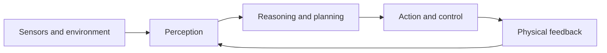

# Defining and Describing Robotic Intelligence

_Robotic intelligence is the capacity of a robot to perceive the physical world, reason about it, learn from feedback, and act adaptively rather than merely replaying fixed instructions._ [^6hqdeb] [^zu2o2z]

In practice, the term describes the integration of sensing, decision-making, learning, planning, and motor control in an embodied machine. [^6hqdeb] [^zu2o2z] It applies when a system must operate amid changing objects, people, surfaces, lighting, and task conditions rather than in a fully scripted environment. [^3ftzqw] [^5q9vpx] The concept matters because it shifts robotics from isolated automation toward systems that can generalize skills, respond to uncertainty, and perform multistep work in the physical world. [^4otrz8] [^3ftzqw]

## Uses in Context

- In robotics research, “robotic intelligence” refers to the coupling of perception, cognition, and action in an embodied system. [^6hqdeb]
- In industrial automation, it describes machines that inspect, manipulate, weld, transport, or assemble while adapting to real-time conditions rather than following only fixed routines. [^6hqdeb] [^5q9vpx]
- In physical-AI discussions, it denotes systems that “perceive, reason, and physically act” in real-world environments. [^6hqdeb]
- In product and startup language, it often means a general-purpose robot “brain” capable of transferring skills across different robot bodies or tasks. [^ye3uws]
- In business strategy, it is associated with autonomous machines that can understand natural-language instructions and execute multistep workflows such as picking and packing. [^4otrz8]

# History of Use

## Origins

The exact first appearance of the phrase “robotic intelligence” is not established by the available search results. The underlying idea, however, is represented in contemporary scholarship and engineering through related terms such as **embodied intelligence**, **physical AI**, and autonomous robotics: systems that learn and act through a physical body in an environment. [^6hqdeb] Recent definitions distinguish this approach from conventional robotics, where machines perform preprogrammed movements with limited adaptation or self-learning. [^zu2o2z]

## Evolution

- **From programmed automation to adaptive robotics:** Traditional robotics emphasized fixed mechanical routines, while newer systems integrate perception, learning, and reasoning so machines can respond to situations not anticipated by programmers. [^zu2o2z] [^5q9vpx]
- **From single-purpose machines to general-purpose systems:** Startups and research teams are developing models intended to teach multiple robots different skills without extensive retraining, including systems designed to operate across varying robot bodies. [^ye3uws] [^tkzyd8]
- **From digital models to [[concepts/Market-Categories/Physical AI|physical-AI]] deployment:** Current approaches combine real-time perception, physics-based simulation, and AI-driven control so robots can learn policies before applying them in real environments. [^3ftzqw] [^5q9vpx]

# Best Real-World Examples

- [Physical Intelligence](https://www.physicalintelligence.company/) — a startup developing general-purpose robot software intended to transfer skills across tasks and embodiments. [^tkzyd8]
- [Skild AI](https://www.skild.ai/) — develops the “Skild Brain,” described as an “omni-bodied” model capable of controlling different robot types. [^ye3uws]
- [Apptronik Apollo](https://apptronik.com/apollo) — a general-purpose humanoid platform designed for physically demanding manufacturing and logistics work, with natural-language and multistep task capabilities demonstrated through a Google DeepMind partnership. [^4otrz8]
- [Sensori Yuri](https://www.onshape.com/en/blog/robotics-startup-sensori-cloud-native-cad-nvidia-isaac-sim-physical-ai) — a mobile humanoid research platform for developing and testing physical-AI policies. [^3ftzqw]
- [LimX Dynamics](https://www.realsenseai.com/case-studies/) — develops full-size, general-purpose humanoid robots for research, manufacturing, business, and household deployment. [^2elw17]
- [ROBOTIS AI WORKER](https://humanoid.press/artificial-intelligence/) — an open-source-oriented experiment connecting a language model to camera perception, robot state, tool selection, and execution feedback for mobile manipulation. [^3msxgz]
- [X Square](https://www.fidelity.com/news/article/default/202611011800RTRSNEWSCOMBINED_L4N4670QC_1) — reported research in which robots acquired object-handling skills from a single human video without retraining for each task. [^tkzyd8]

# Case Studies

**Sensori and Yuri.** Sensori, a Texas robotics startup, is developing Yuri as a wheel-based humanoid platform for training physical-AI policies. [^3ftzqw] The system is used to connect computer-aided design, simulation, and real-world testing, addressing the difficulty of teaching a robot to perceive its environment, make decisions, and interact safely with physical objects. [^3ftzqw] The case shows that robotic intelligence depends not only on a large model but also on data collection, simulation, embodiment, and policy validation across the digital-to-physical boundary. [^3ftzqw]

**Apptronik and Apollo.** Apptronik developed Apollo as a general-purpose humanoid robot for work alongside people in manufacturing, logistics, and other physically demanding settings. [^4otrz8] Through a partnership with Google DeepMind, Apollo was connected to visual-language-action models capable of interpreting natural-language instructions, reasoning through multistep workflows, and manipulating unfamiliar objects in dynamic environments. [^4otrz8] The case illustrates how robotic intelligence turns a robot from a mechanically capable platform into an adaptable worker, while also showing that large technology companies are increasingly acting as model and infrastructure adopters around startup-built robotic systems. [^4otrz8]

**[[Tooling/Hardware/Robotics/Skild AI|Skild AI]] and the omni-bodied model.** Skild AI’s “Skild Brain” is designed to control different robots without requiring exact prior knowledge of each robot’s body. [^ye3uws] This approach addresses a central limitation of conventional robotics: skills and control policies are often tightly coupled to one machine, making deployment expensive when hardware changes. [^ye3uws] The case demonstrates the concept’s broader direction—intelligence becoming a transferable software layer that can coordinate perception, planning, and action across embodiments rather than remaining locked to a single-purpose robot. [^ye3uws]

***

# Sources

[^2elw17]: 2026, Aug 26. [realsenseai.com](https://www.realsenseai.com/). [Case Studies](https://www.realsenseai.com/case-studies/). Updated: 2026, Nov 06. Generated: 2026, Nov 06. [Perplexity](https://www.perplexity.ai/) API response.
[^4otrz8]: 2026, Oct 30. [cloud.google.com](https://cloud.google.com/). [How startups are advancing robotics with Google AI](https://cloud.google.com/transform/startups-advancing-robotics-with-google-ai-google-deep-mind-seven-examples). Updated: 2026, Oct 31. Generated: 2026, Nov 06. [Perplexity](https://www.perplexity.ai/) API response.
[^3ftzqw]: 2026, Oct 21. [onshape.com](https://www.onshape.com/). [How Robotics Startup Sensori Moves from ...](https://www.onshape.com/en/blog/robotics-startup-sensori-cloud-native-cad-nvidia-isaac-sim-physical-ai). Updated: 2026, Nov 06. Generated: 2026, Nov 06. [Perplexity](https://www.perplexity.ai/) API response.
[^6hqdeb]: 2026, Sep 22. [techaheadcorp.com](https://www.techaheadcorp.com/). [Embodied Intelligence Is Redefining Industrial Operations](https://www.techaheadcorp.com/blog/how-embodied-intelligence-redefining-industrial-operation/). Updated: 2026, Nov 06. Generated: 2026, Nov 06. [Perplexity](https://www.perplexity.ai/) API response.
[^ye3uws]: 2026, Feb 02. [nvidia.com](https://www.nvidia.com/). [Skild AI Builds Omni-Bodied Robot Brain With NVIDIA | NVIDIA](https://www.nvidia.com/en-us/case-studies/skild-ai/). Updated: 2026, Oct 26. Generated: 2026, Nov 06. [Perplexity](https://www.perplexity.ai/) API response.
[^3msxgz]: 2026, Jun 11. [humanoid.press](https://humanoid.press/). [Physical AI & Embodied AI Daily News | Humanoid Robot Intelligence](https://humanoid.press/artificial-intelligence/). Updated: 2026, Nov 06. Generated: 2026, Nov 06. [Perplexity](https://www.perplexity.ai/) API response.
[^zu2o2z]: 2026, May 29. [tredence.com](https://www.tredence.com/). [Physical AI: The Future of Intelligent Robotic Systems | Tredence](https://www.tredence.com/blog/physical-ai). Updated: 2026, Oct 03. Generated: 2026, Nov 06. [Perplexity](https://www.perplexity.ai/) API response.
[^5q9vpx]: 2026, Jan 28. [softserveinc.com](https://www.softserveinc.com/). [Scaling Physical AI and Robotics with SoftServe and NVIDIA](https://www.softserveinc.com/en-us/blog/scaling-physical-ai-robotics-softserve-nvidia). Updated: 2026, Oct 26. Generated: 2026, Nov 06. [Perplexity](https://www.perplexity.ai/) API response.
[9]: 2026, Mar 02. [deloitte.com](https://www.deloitte.com/). [Spark progress with Physical AI](https://www.deloitte.com/global/en/services/consulting/services/deloitte-nvidia-alliance-physical-ai.html). Updated: 2026, Oct 10. Generated: 2026, Nov 06. [Perplexity](https://www.perplexity.ai/) API response.
[^tkzyd8]: 2026, Nov 01. [fidelity.com](https://www.fidelity.com/). [FOCUS-China's robot makers have mastered the moves. Now comes the race for brains](https://www.fidelity.com/news/article/default/202611011800RTRSNEWSCOMBINED_L4N4670QC_1). Generated: 2026, Nov 06. [Perplexity](https://www.perplexity.ai/) API response.
